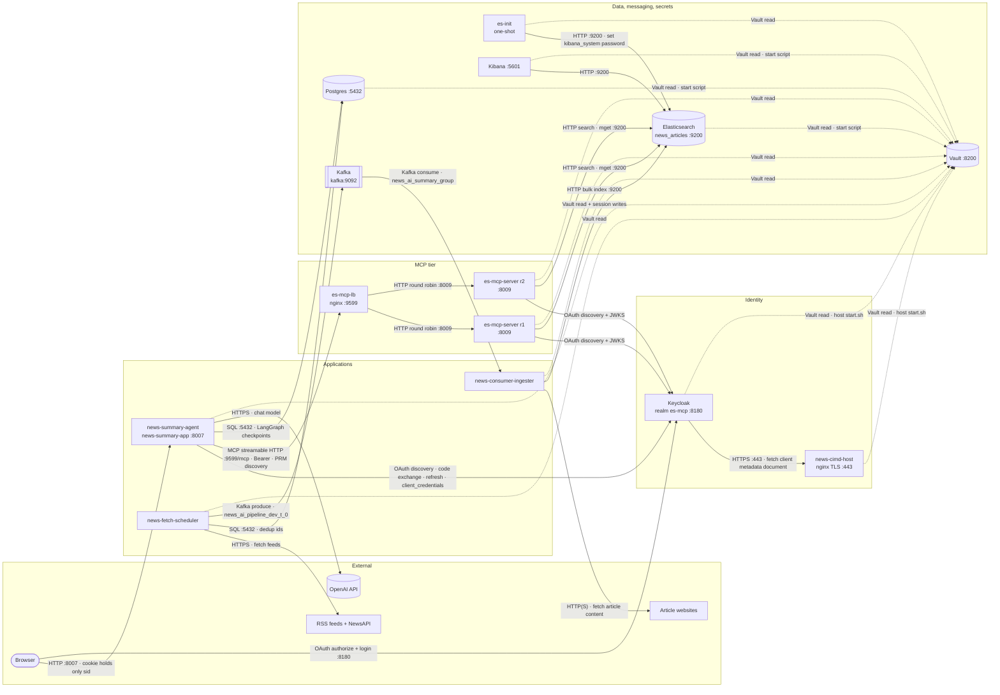

# docker_services

Local infrastructure for the news pipeline: identity (Keycloak, CIMD host), the MCP load
balancer, data stores (Elasticsearch, Postgres), messaging (Kafka) and secrets (Vault).
The application repos (news-summary-agent, es-mcp-server, news-fetch-scheduler,
news-consumer-ingester) run beside these containers on the same Docker networks.

This file holds the **canonical architecture diagram** and the **port registry**. Each
directory has its own README; the pipeline components' READMEs (vault_server, keycloak,
news-cimd-host, es-mcp-lb, elasticsearch, postgres, kafka, and the four application repos) also
show their slice of the diagram. mongodb, redis, qdrant, pypi-server, cimd-host and mcp-lab-lb
are not in the diagram and have no slice.

## Architecture

Solid arrows are requests (label: protocol, port, purpose). Dotted arrows are Vault reads;
news-summary-agent also writes its login sessions there.

Each component README shows a slice of this diagram: the component (highlighted), its own edges,
and the request paths it takes part in, followed to where the data ends up. Other components'
Vault reads are left out of slices to keep them readable.

Containers reach each other by name on two external Docker networks: `services_network`
(every container here except `vault-server`, and except the retired pypi-server, which used its
own `infra-network`) and `vault-network` (`vault-server` itself, which is on this network only,
plus the containers that call Vault from inside). On the host, `/etc/hosts` (and the Windows hosts file) map
`es-mcp-lb`, `keycloak`, `news-summary-app`, `elasticsearch`, `postgres`, `vault-server` and
`kibana` to `127.0.0.1`; `kafka`, `es-mcp-server-r1`/`-r2` and `news-cimd-host` are **not**
mapped (host clients use `localhost:29092` for Kafka and `127.0.0.1:9551`/`9552` for the
replicas; news-cimd-host has no host port). The infrastructure ports below are bound to
loopback (`127.0.0.1`), application ports included.

## Port registry

| Component | Container | Host port | Container port | Host bind | Defined in |
|---|---|---|---|---|---|
| news-summary-agent | news-summary-app | 8007 | 8007 | 127.0.0.1 | news-summary-agent/docker-compose.yml |
| es-mcp-server r1 | es-mcp-server-r1 | 9551 | 8009 | 127.0.0.1 | es-mcp-server/docker-compose.yml |
| es-mcp-server r2 | es-mcp-server-r2 | 9552 | 8009 | 127.0.0.1 | es-mcp-server/docker-compose.yml |
| es-mcp-lb | es-mcp-lb | 9599 | 9599 | 127.0.0.1 | es-mcp-lb/docker-compose.yml |
| Keycloak | keycloak | 8180 | 8180 (9000 management, not published) | 127.0.0.1 | keycloak/docker-compose.yml |
| news-cimd-host | news-cimd-host | — | 443 TLS (8081 health, container loopback) | network only | news-cimd-host/docker-compose.yml |
| Elasticsearch | elasticsearch | 9200 | 9200 (9300 transport, not published) | 127.0.0.1 | elasticsearch/docker-compose.yml |
| Kibana | kibana | 5601 | 5601 | 127.0.0.1 | elasticsearch/docker-compose.yml |
| Postgres | postgres | 5432 | 5432 | 127.0.0.1 | postgres/docker-compose.yml |
| Vault | vault-server | 8200 | 8200 | 127.0.0.1 | vault_server/docker-compose.yml |
| Kafka | kafka | 29092 | 29092 (`kafka:9092` in-network, 9093 controller) | 127.0.0.1 | kafka/docker-compose.yml |
| Kafka UI | kafka-ui | 8082 | 8080 | 127.0.0.1 | kafka/docker-compose.yml |
| news-fetch-scheduler | news_fetch_scheduler | — | — | — | news-fetch-scheduler/docker-compose.yml |
| news-consumer-ingester | news_consumer_ingester | — | — | — | news-consumer-ingester/docker-compose.yml |

Not used by the news pipeline:

| Component | Container | Host port | Container port | Host bind | Defined in |
|---|---|---|---|---|---|
| MongoDB | mongodb | 27017 | 27017 | 127.0.0.1 | mongodb/docker-compose.yml |
| Mongo Express | mongo-express | 8081 | 8081 | 127.0.0.1 (no login) | mongodb/docker-compose.yml |
| Redis | redis | 6379 | 6379 | 127.0.0.1 | redis/docker-compose.yml |
| RedisInsight | redisinsight | 5540 | 5540 | 127.0.0.1 | redis/docker-compose.yml |
| Qdrant | qdrant | 6333, 6334 | 6333 REST, 6334 gRPC | 127.0.0.1 | qdrant/docker-compose.yml |
| PyPI server (retired, not started) | pypi-server | 8080 | 8080 | 0.0.0.0 | pypi-server/docker-compose.yml |

## Vault paths

KV v2 at mount `secret/`. Key names only; values live in Vault.

| Path | Keys | Read by |
|---|---|---|
| `secret/CREDENTIALS` | `POSTGRES_DB`, `POSTGRES_USER`, `POSTGRES_PASSWORD` | postgres, news-summary-agent, news-fetch-scheduler |
| | `ELASTIC_PASSWORD` | elasticsearch, es-init |
| | `KIBANA_SYSTEM_PASSWORD` | es-init, kibana |
| | `KIBANA_ENCRYPTION_KEY` | kibana |
| | `ELASTIC_API_KEY` | news-consumer-ingester (writes the index) |
| | `ELASTIC_READ_API_KEY`, `ES_MCP_SERVER_SHARED_SYMMETRIC_KEY` | es-mcp-server |
| | `NEWS_API_KEY` | news-fetch-scheduler |
| | `OPENAI_API_KEY` | news-summary-agent (read by the OpenAI client) |
| | `KC_ADMIN_USER`, `KC_ADMIN_PASSWORD` | keycloak/start.sh |
| | `NEWS_MCP_CIMD_HOST_TLS_KEY`, `LOCAL_NEWS_MCP_CIMD_CA_KEY` | news-cimd-host/start.sh reads the TLS key; make-certs.sh writes both |
| | `MONGO_USER`, `MONGO_PASSWORD` | mongodb, mongo-express |
| | `REDIS_PASSWORD` | redis |
| | `MCP_LAB_CIMD_HOST_TLS_KEY`, `LOCAL_CA_KEY` | legacy cimd-host/start.sh reads the TLS key; legacy cimd-host/make-certs.sh writes both (not used by the news pipeline) |
| `secret/NEWS-SUMMARY-APP/CONFIG` | `SERVICE_CLIENT_SECRET`, `NEWS_APP_SESSION_SECRET` | news-summary-agent |
| `secret/NEWS-SUMMARY-APP/SESSIONS/<sid>` | `refresh_token`, `sub` (one entry per login) | news-summary-agent (read and write; deletes expired entries at start-up and daily) |

Every application loads **all** keys at its paths into its process environment at start-up.

## Directories

| Directory | What it is | README |
|---|---|---|
| `vault_server/` | Vault (file storage, Shamir seal): secrets for everything | [vault_server/README.md](vault_server/README.md) |
| `keycloak/` | Keycloak: login for the app, tokens for es-mcp-server | [keycloak/README.md](keycloak/README.md) |
| `news-cimd-host/` | nginx serving the app's OAuth Client ID Metadata Document | [news-cimd-host/README.md](news-cimd-host/README.md) |
| `es-mcp-lb/` | nginx round-robin load balancer over the es-mcp-server replicas | [es-mcp-lb/README.md](es-mcp-lb/README.md) |
| `elasticsearch/` | Elasticsearch, Kibana and the es-init job | [elasticsearch/README.md](elasticsearch/README.md) |
| `postgres/` | Postgres 16 (checkpoints, dedup) | [postgres/README.md](postgres/README.md) |
| `kafka/` | Kafka (KRaft) and Kafka UI: the article queue | [kafka/README.md](kafka/README.md) |
| `mongodb/`, `redis/`, `qdrant/`, `pypi-server/` | Other local services, not used by the news pipeline | each directory's README |
| `log-collector/` | Vector: copies the infrastructure containers' stdout/stderr to `~/github/logs/services/` | [log-collector/README.md](log-collector/README.md) |
| `cimd-host/`, `mcp-lab-lb/` | Legacy lab setup, superseded by `news-cimd-host/` and `es-mcp-lb/` | each directory's README |

## Logs

| What | Where | Retention |
|---|---|---|
| Applications (news-summary-agent, es-mcp-server replicas, scheduler, ingester) | their own files in `~/github/logs/*.log` (bind-mounted `/app/logs`) | daily at midnight UTC (`TimedRotatingFileHandler`), 14 rotated files kept (`<name>.log.YYYY-MM-DD`) |
| Infrastructure containers | `~/github/logs/services/<container>/YYYY-MM-DD.log`, written by [log-collector](log-collector/README.md) | `LOG_RETENTION_DAYS` (14) |
| Docker's own copy (`docker logs`) | Docker's `json-file` store | every service: 3 × 10 MB, oldest deleted automatically |

## Start order

Containers read Vault when they start, so Vault must be up and unsealed first.

1. `vault_server` — then unseal (3 keys).
2. `postgres`, `elasticsearch` (elasticsearch → es-init → kibana), `kafka`.
3. `keycloak/start.sh up -d`, `news-cimd-host/start.sh up -d` (they read their secrets from Vault on the host).
4. `es-mcp-server` (both replicas) and `es-mcp-lb`. es-mcp-lb resolves the replica names at run
   time (nginx `resolve`), so it starts without them and their relative order is optional.
5. `news-summary-agent`, `news-fetch-scheduler`, `news-consumer-ingester`.

`VAULT_TOKEN` must be exported in the shell for the stacks that read Vault:

- postgres, elasticsearch, mongodb, redis: their compose files hand it to the containers as the
  Compose secret `vault_token` (file `/run/secrets/vault_token`);
- the four application repos: they still pass it as the `VAULT_TOKEN` environment variable;
- `keycloak/start.sh` and `news-cimd-host/start.sh` (and the legacy `cimd-host/start.sh`): they
  need `VAULT_ADDR` and `VAULT_TOKEN` for the vault CLI on the host.

vault_server, kafka, qdrant, es-mcp-lb and mcp-lab-lb do not use it.
