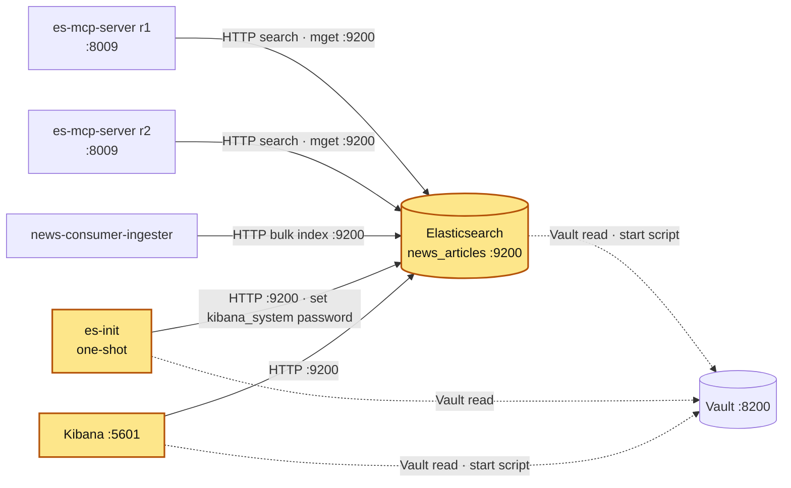

# elasticsearch

## Purpose

The article store of the news pipeline. news-consumer-ingester bulk-indexes fetched articles
into index `news_articles`; es-mcp-server searches it (lexical only: `multi_match` on `title`/`content`) and serves the results
to news-summary-agent over MCP. This compose project has three services:

| Service | Role |
|---|---|
| `elasticsearch` | single-node Elasticsearch, security on |
| `es-init` | one-shot job: sets the `kibana_system` user's password |
| `kibana` | UI / Dev Tools for the cluster |

## How it is set up

| Item | elasticsearch | es-init | kibana |
|---|---|---|---|
| Image | `elasticsearch:9.2.3` | `curlimages/curl:8.21.0` | built from `Dockerfile_kibana` (`FROM kibana:9.2.3`, adds `start-kibana.sh`) |
| Command | `bash /start-elasticsearch.sh` → `docker-entrypoint.sh eswrapper` | `sh /es-init.sh` | `bash /start-kibana.sh` → `kibana-docker` |
| Secrets from Vault (in container, `GET $VAULT_ADDR/v1/secret/data/CREDENTIALS`) | `ELASTIC_PASSWORD` | `ELASTIC_PASSWORD`, `KIBANA_SYSTEM_PASSWORD` | `KIBANA_SYSTEM_PASSWORD` (as `ELASTICSEARCH_PASSWORD`, user `kibana_system`), `KIBANA_ENCRYPTION_KEY` (as `XPACK_ENCRYPTEDSAVEDOBJECTS_ENCRYPTIONKEY`) |
| Vault token | Compose secret `vault_token` ← host env `VAULT_TOKEN`, read from `/run/secrets/vault_token` (not an env var) | same | same |
| Key settings | `discovery.type=single-node`, `xpack.security.enabled=true`, `ES_JAVA_OPTS=-Xms1g -Xmx1g`, `path.repo=/usr/share/elasticsearch/snapshots` | `ES_URL` default `http://elasticsearch:9200` | `ELASTICSEARCH_HOSTS=http://elasticsearch:9200` |
| Volumes | `es_data` → `/usr/share/elasticsearch/data`; `./start-elasticsearch.sh` | `./es-init.sh:ro` | `./start-kibana.sh` |
| Healthcheck | `curl http://localhost:9200` returns 200 or 401 (no credentials), 60s interval, 10 retries, 60s start | — | `curl /api/status` returns 200, 30s, 10 retries, 120s start |
| Start dependency | — | `elasticsearch` healthy | `es-init` completed successfully |
| Restart | `unless-stopped` | `"no"` (one-shot) | `unless-stopped` |
| Networks | `vault-network`, `services_network` | same | same |

Each start script waits for Vault (`/v1/sys/health`, 30 × 3 s), fetches the secret, checks it is
non-empty and never prints values. es-init retries the password call until ES returns 200.

### Index `news_articles`

Definition kept in `~/github/news-consumer-ingester/src/resources/elastic_schema.MD`
(Dev Tools notes, not applied automatically):

| Field | Type | Written by ingester |
|---|---|---|
| `article_id` | keyword (also the document `_id`, so re-ingest overwrites) | yes |
| `title` | text, `english` analyzer | yes |
| `content` | text, `english`; sub-field `content.semantic` = `semantic_text` with `inference_id: news-embedding-endpoint` (model `.multilingual-e5-small_linux-x86_64`); in the mapping, but not queried yet by es-mcp-server | yes |
| `link` | keyword, `index: false` | yes |
| `published_at` | date (`strict_date_optional_time\|\|epoch_millis`) | yes |
| `fetched_at` | date (same format) | yes |
| `source` | keyword | yes |

Mapping is `dynamic: strict`, `refresh_interval: 30s`. Fields match what
`news-consumer-ingester/src/ingester/elastic_ingester.py` writes.

UNVERIFIED (not checked against the live cluster, which needs credentials): whether
`news_articles` is a concrete index or an alias to `news_articles_v1` (the notes contain a
reindex + `_aliases` step), and whether the `news-embedding-endpoint` inference endpoint and ML
model are deployed locally (the notes also contain a "serverless mode" error, so parts were run
against another cluster).

**Logs:** `elasticsearch`, `es-init`, `kibana` log to stdout/stderr. Docker keeps that copy (`docker logs <container>`), rotated at 3 × 10 MB per container with the oldest file deleted automatically (`logging:` in `docker-compose.yml`). [log-collector](../log-collector/README.md) also copies it to `~/github/logs/services/<container>/YYYY-MM-DD.log`, kept 14 days.

## Where it fits

Slice of the [canonical diagram](../README.md#architecture).



## Depends on / Depended on by

**Depends on**

| Component | What for |
|---|---|
| Vault | `secret/CREDENTIALS` → `ELASTIC_PASSWORD` (elasticsearch, es-init), `KIBANA_SYSTEM_PASSWORD` (es-init, kibana), `KIBANA_ENCRYPTION_KEY` (kibana) |
| `es_data` volume | indices, security index (users, API keys) |

**Depended on by**

| Component | What for |
|---|---|
| news-consumer-ingester | writes index `news_articles` (`ES_INDEX` in `application_config.toml`) with `_op_type: index` bulk requests, `_id = article_id`; authenticates with API key `ELASTIC_API_KEY` (Vault `secret/CREDENTIALS`) |
| es-mcp-server r1/r2 | reads `news_articles` (`ES_INDEX` in `application-config.yaml`, `ELASTIC_URL: http://elasticsearch:9200`) with `search` and `mget`; API key `ELASTIC_READ_API_KEY` |
| kibana / es-init | as above (internal to this project) |

The API keys themselves are created in Elasticsearch by hand; their privileges are UNVERIFIED.

## Config & secrets

| Kind | Name |
|---|---|
| Vault path (HTTP API form) | `VAULT_SECRET_PATH=secret/data/CREDENTIALS` (= `secret/CREDENTIALS` in the CLI) |
| Vault keys | `ELASTIC_PASSWORD`, `KIBANA_SYSTEM_PASSWORD`, `KIBANA_ENCRYPTION_KEY` |
| Env | `VAULT_ADDR=http://vault-server:8200`, `VAULT_SECRET_PATH`, settings in the table above |
| Compose secret | `vault_token` ← host `VAULT_TOKEN` |
| Files | `start-elasticsearch.sh`, `es-init.sh`, `start-kibana.sh`, `Dockerfile_kibana` |

Users: `elastic` (superuser, `ELASTIC_PASSWORD`), `kibana_system` (`KIBANA_SYSTEM_PASSWORD`).

## Run locally

Prerequisites: Vault up and unsealed; networks `vault-network` and `services_network` exist.

```bash
export VAULT_TOKEN=...
cd ~/github/docker_services/elasticsearch
docker compose up -d --build      # elasticsearch → es-init → kibana
docker compose logs -f es-init    # should end with "kibana_system password set successfully"
```

Also included by the root `../docker-compose.yml`. Start before es-mcp-server and
news-consumer-ingester.

## Test

```bash
docker inspect -f '{{.State.Health.Status}}' elasticsearch kibana
docker inspect -f '{{.State.ExitCode}}' es-init                    # 0
curl -s -o /dev/null -w '%{http_code}\n' http://127.0.0.1:9200     # 401 = up, security on
curl -s -o /dev/null -w '%{http_code}\n' http://127.0.0.1:5601/api/status   # 200
# With credentials (prompted, not echoed):
curl -s -u elastic http://127.0.0.1:9200/_cluster/health | jq .status
curl -s -u elastic 'http://127.0.0.1:9200/_cat/indices/news_articles*?v'
curl -s -u elastic http://127.0.0.1:9200/_alias/news_articles
```

## Ports

| Host | Container | Bind | Note |
|---|---|---|---|
| 9200 | 9200 | 127.0.0.1 | REST API |
| — | 9300 | not published | transport |
| 5601 | 5601 | 127.0.0.1 | Kibana |

## Troubleshooting

| Symptom | Cause | Fix |
|---|---|---|
| `❌ VAULT_TOKEN not set` in logs | `VAULT_TOKEN` not exported when running compose (secret file empty) | `export VAULT_TOKEN=...`, `docker compose up -d --force-recreate` |
| `❌ Vault not reachable` | Vault sealed/down, or container not on `vault-network` | unseal Vault |
| `❌ ... is empty` | key missing at `secret/CREDENTIALS`, or its value contains `"` (scripts parse JSON with grep/sed) | add/fix the key in Vault |
| Kibana never starts | es-init failed, so `service_completed_successfully` not met | `docker compose logs es-init`; fix, then `docker compose up -d` |
| Kibana "unable to authenticate kibana_system" | Vault `KIBANA_SYSTEM_PASSWORD` changed after es-init ran | `docker compose up -d --force-recreate es-init kibana` |
| ES exits, `max virtual memory areas vm.max_map_count` | host kernel setting too low (WSL) | `sudo sysctl -w vm.max_map_count=262144` |
| ingester bulk errors `strict_dynamic_mapping_exception` | document has a field not in the mapping | align ingester and mapping |
| ingester bulk errors: inference endpoint not found (`semantic_text` embeds `content.semantic` at index time; no query uses it yet) | `news-embedding-endpoint` / ML model not deployed | run the setup in `elastic_schema.MD` |
