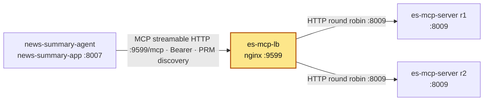

# es-mcp-lb

## Purpose

nginx round-robin load balancer in front of the two es-mcp-server replicas. Its address,
`http://es-mcp-lb:9599/mcp`, is the single MCP endpoint news-summary-agent calls **and** the
OAuth resource / token audience: Keycloak issues tokens for this URL, and every replica checks
`aud = http://es-mcp-lb:9599/mcp`. Replicas are interchangeable behind it.

## How it is set up

| Item | Value |
|---|---|
| Image | `nginx:1.30.6-alpine` |
| Container | `es-mcp-lb` |
| Config | `./nginx.conf` → `/etc/nginx/conf.d/default.conf:ro` |
| Upstream `es_mcp_backend` | `es-mcp-server-r1:8009`, `es-mcp-server-r2:8009`, round robin, `resolve` with Docker DNS `127.0.0.11 valid=10s` (shared `zone`), so nginx starts even if a replica does not exist yet and picks up new IPs |
| Passive health | `max_fails=2 fail_timeout=10s` per server (open-source nginx: no active checks) |
| Connections | `keepalive 16`, `proxy_http_version 1.1`, empty `Connection` header |
| Failover | `proxy_connect_timeout 5s`, `proxy_next_upstream error timeout` |
| Streaming | `proxy_buffering off`, `proxy_read_timeout 300s` (SSE responses of MCP streamable HTTP) |
| Host header | `proxy_set_header Host $http_host` — forwarded unchanged, because replicas only accept Host `es-mcp-lb:9599` (DNS-rebinding protection, `MCP_ALLOWED_HOSTS`); nginx's default would send the upstream name and get HTTP 421 |
| Other headers | `X-Forwarded-For`, `X-Forwarded-Proto`, `X-Real-IP` |
| Access log | format `upstream_log`: `$remote_addr "$request" $status upstream=$upstream_addr` |
| Healthcheck | `wget http://127.0.0.1:9599/lb-healthz` (LB's own liveness, not the replicas'), 15s, 3 retries |
| Secrets | none (no Vault access; tokens pass through untouched) |
| Network | `services_network` (external) |
| Restart | `unless-stopped` |

**Logs:** `es-mcp-lb` logs to stdout/stderr. Docker keeps that copy (`docker logs <container>`), rotated at 3 × 10 MB per container with the oldest file deleted automatically (`logging:` in `docker-compose.yml`). [log-collector](../log-collector/README.md) also copies it to `~/github/logs/services/<container>/YYYY-MM-DD.log`, kept 14 days. nginx's `access.log`/`error.log` are symlinks to stdout/stderr, so access and error lines are in both places.

## Where it fits

Slice of the [canonical diagram](../README.md#architecture).



## Depends on / Depended on by

**Depends on**

| Component | What for |
|---|---|
| es-mcp-server r1/r2 (`~/github/es-mcp-server`, containers `es-mcp-server-r1`, `es-mcp-server-r2`) | backends on `:8009`; they validate the Bearer token themselves |
| Docker DNS on `services_network` | resolving replica names at request time |

**Depended on by**

| Component | What for |
|---|---|
| news-summary-agent | `MCP_URL: http://es-mcp-lb:9599/mcp` — MCP calls with a `client_credentials` Bearer token; same URL is the `resource` it requests from Keycloak |
| Keycloak / es-mcp-server (by name only) | `http://es-mcp-lb:9599/mcp` is the audience es-mcp-server requires (`audience` in es-mcp-server `application-config.yaml`) |

## Config & secrets

- `nginx.conf` only. No env vars, no Vault paths, no secrets.
- Changing the listen port or name breaks the token audience and the replicas'
  `MCP_ALLOWED_HOSTS`; change all three together.

## Run locally

Prerequisites: `services_network` exists. Start the es-mcp-server replicas first
(see [start order](../README.md#start-order)); thanks to `resolve` the LB also starts without them.

```bash
cd ~/github/docker_services/es-mcp-lb
docker compose up -d
docker compose exec es-mcp-lb nginx -s reload    # after editing nginx.conf
```

No `VAULT_TOKEN` needed for this compose file.

## Test

```bash
docker inspect -f '{{.State.Health.Status}}' es-mcp-lb
curl -s http://127.0.0.1:9599/lb-healthz                 # ok
docker exec es-mcp-lb nginx -t
# Unauthenticated MCP call: 401 from a replica proves the LB routes to a live backend
curl -s -o /dev/null -w '%{http_code}\n' -H 'Host: es-mcp-lb:9599' -X POST http://127.0.0.1:9599/mcp   # 401
docker logs --tail 20 es-mcp-lb                          # upstream=<ip>:8009 alternates
```

An unauthenticated request gets 401 whatever its Host header (checked), so the Host check is
only exercised with a valid token.

## Ports

| Host | Container | Bind |
|---|---|---|
| 9599 | 9599 | 127.0.0.1 |

(`docker ps` also lists `80/tcp` from the image's EXPOSE; nothing listens there.)

## Troubleshooting

| Symptom | Cause | Fix |
|---|---|---|
| HTTP 421 Misdirected Request (authenticated call) | Host header is not `es-mcp-lb:9599` (e.g. called as `localhost:9599`) | call `http://es-mcp-lb:9599/mcp` (host `/etc/hosts` maps it to 127.0.0.1) or send `-H 'Host: es-mcp-lb:9599'` |
| HTTP 502 / 504 | both replicas down or unreachable | `docker ps` the replicas; check they are on `services_network` |
| Every second request slow / fails | one replica dead; nginx marks it failed only after `max_fails=2` | fix the replica; failover retries on `error timeout` |
| SSE stream cut after ~5 min idle | `proxy_read_timeout 300s` | expected; client reconnects |
| HTTP 401 from replica | token missing, expired, or wrong audience | token must be requested with `resource=http://es-mcp-lb:9599/mcp` |
