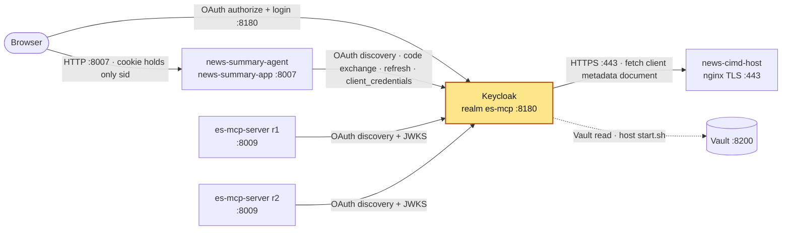

# keycloak

## Purpose

Keycloak is the OAuth 2.1 / OIDC authorization server for the news pipeline (realm `es-mcp`,
issuer `http://keycloak:8180/realms/es-mcp`). It:

- logs users in to news-summary-agent (authorization code + PKCE, public client registered by
  **CIMD** — Client ID Metadata Document — fetched from news-cimd-host);
- issues service tokens (`client_credentials`) that news-summary-agent uses to call es-mcp-server
  through es-mcp-lb, with audience `http://es-mcp-lb:9599/mcp` (RFC 8707 resource indicators);
- publishes OIDC discovery and JWKS that es-mcp-server uses to validate those tokens.

Runs in development mode (`start-dev`: H2 file database, HTTP, no production hardening).

## How it is set up

| Item | Value |
|---|---|
| Image | `quay.io/keycloak/keycloak:26.8.1` |
| Container | `keycloak` |
| Command | `kc.sh start-dev --features=cimd,resource-indicators --import-realm` (via a bash entrypoint) |
| Secrets | `keycloak/start.sh` on the **host** reads `KC_ADMIN_USER` and `KC_ADMIN_PASSWORD` from Vault (`vault kv get`, path `secret/CREDENTIALS`, override with `KC_VAULT_PATH`) and exports them for one `docker compose` command. The password goes in as Compose secret `kc_admin_password` (`/run/secrets/kc_admin_password`); the entrypoint refuses to start if that file is empty. The username goes in as env `KC_BOOTSTRAP_ADMIN_USERNAME` |
| Realm import | `./realm` → `/opt/keycloak/data/import:ro`. It holds `realm/mcp-lab-realm.json` plus `realm/exports/` (`realm-export.json`, `mcp-lab-client-policies.json`, `mcp-lab-client-profiles.json`); all of it is the legacy lab realm `mcp-lab`. Import is attempted at every start and skips realms that already exist (`mcp-lab` does) |
| Realm `es-mcp` | lives only in the `keycloak_data` volume (created in the admin console, not imported) |
| Volumes | `keycloak_data` → `/opt/keycloak/data` (H2 DB; `down -v` wipes all realms); `../news-cimd-host/certs/ca.crt` → `/opt/keycloak/conf/truststores/docker-services-local-ca.pem:ro` |
| Truststore | `KC_TRUSTSTORE_PATHS=/opt/keycloak/conf/truststores`, so Keycloak trusts the local CA that signed news-cimd-host's TLS cert |
| Hostname | `KC_HOSTNAME=http://keycloak:8180`, `KC_HTTP_PORT=8180`, `KC_HOSTNAME_BACKCHANNEL_DYNAMIC=true` (back-channel URLs follow the caller's host) |
| Health | `KC_HEALTH_ENABLED=true`; healthcheck uses bash `/dev/tcp` on management port 9000 `GET /health/ready`, expects `"UP"` (15s interval, 10 retries, 40s start) |
| Network | `services_network` (external). Not on `vault-network`: Vault is read on the host |
| Restart | `unless-stopped` |

### Clients in realm `es-mcp`

| Client | Type | Used for |
|---|---|---|
| `https://news-cimd-host/clients/news-summary-app-cimd.json` | public CIMD client, `token_endpoint_auth_method: none`, grants `authorization_code`, `refresh_token`; redirect `http://news-summary-app:8007/auth/callback` | browser login to news-summary-agent (BFF) |
| `news-summary-app-svc` | confidential, service account | `client_credentials` token to call es-mcp-server; secret is `SERVICE_CLIENT_SECRET` in Vault `secret/NEWS-SUMMARY-APP/CONFIG` |

**Backup:** `backup/realm-export.json` is a full export of the `es-mcp` realm (both clients,
their audience mappers, the `news-cimd-policy` client policy). Client secrets are masked
(`**********`) and it holds no user credentials or key material, so it is safe in git. It is
**not** in the import directory (`./realm`) on purpose: importing a masked secret would silently
break `news-summary-app-svc`.

To restore `es-mcp` from it (e.g. after the `keycloak_data` volume is lost):
1. Import it: Admin console → *Create realm* → upload `backup/realm-export.json`
   (or copy it into `./realm/` for one start with `--import-realm`, then remove it again).
2. Set `news-summary-app-svc`'s client secret back to the Vault value `SERVICE_CLIENT_SECRET`
   (`secret/NEWS-SUMMARY-APP/CONFIG`): *Clients → news-summary-app-svc → Credentials*.
   Until then the app's service token fetch fails and queries return "Search is unavailable".

**Logs:** `keycloak` logs to stdout/stderr. Docker keeps that copy (`docker logs <container>`), rotated at 3 × 10 MB per container with the oldest file deleted automatically (`logging:` in `docker-compose.yml`). [log-collector](../log-collector/README.md) also copies it to `~/github/logs/services/<container>/YYYY-MM-DD.log`, kept 14 days.

## Where it fits

Slice of the [canonical diagram](../README.md#architecture).



## Depends on / Depended on by

**Depends on**

| Component | What for |
|---|---|
| Vault (via host `start.sh`) | `secret/CREDENTIALS` → `KC_ADMIN_USER`, `KC_ADMIN_PASSWORD` (bootstrap admin) |
| news-cimd-host | HTTPS fetch of `/clients/news-summary-app-cimd.json` when the CIMD client is used (Keycloak caches it, min 300 s) |
| `news-cimd-host/certs/ca.crt` | trust anchor for that HTTPS fetch |
| `keycloak_data` volume | realm `es-mcp`, its clients, users and keys |

**Depended on by**

| Component | What for |
|---|---|
| Browser | authorize + login pages at `http://keycloak:8180/realms/es-mcp/...` (host `/etc/hosts` maps `keycloak` to 127.0.0.1) |
| news-summary-agent | code exchange + refresh for the CIMD client; `client_credentials` for `news-summary-app-svc` with resource `http://es-mcp-lb:9599/mcp`; checks `ALLOWED_ISSUER_URL=http://keycloak:8180/realms/es-mcp` |
| es-mcp-server r1/r2 | OIDC discovery + JWKS of `issuer_realm: http://keycloak:8180/realms/es-mcp`; validates `aud=http://es-mcp-lb:9599/mcp` |

## Config & secrets

| Kind | Name | Source |
|---|---|---|
| Vault | `secret/CREDENTIALS` → `KC_ADMIN_USER`, `KC_ADMIN_PASSWORD` | read by `start.sh` (host) |
| Host env | `VAULT_ADDR`, `VAULT_TOKEN` (required), `KC_VAULT_PATH` (optional) | your shell |
| Compose secret | `kc_admin_password` ← env `KC_ADMIN_PASSWORD` | set by `start.sh` |
| Container env | `KC_BOOTSTRAP_ADMIN_USERNAME`, `KC_HOSTNAME`, `KC_HTTP_PORT`, `KC_HOSTNAME_BACKCHANNEL_DYNAMIC`, `KC_HEALTH_ENABLED`, `KC_TRUSTSTORE_PATHS` | docker-compose.yml |
| Files | `realm/mcp-lab-realm.json` (imported, legacy); `realm/exports/*` (legacy mcp-lab exports; mounted with the directory, but whether `--import-realm` reads the subdirectory is UNVERIFIED — they hold no new realm, and existing realms are skipped anyway) | this directory |

There is no `.env` file. Plain `docker compose` here fails (`KC_ADMIN_USER` is required).

## Run locally

Prerequisites: Vault up and unsealed, `services_network` exists, `news-cimd-host/certs/ca.crt`
exists (run `news-cimd-host/make-certs.sh` once).

```bash
export VAULT_ADDR=http://127.0.0.1:8200 VAULT_TOKEN=...
cd ~/github/docker_services/keycloak
./start.sh up -d          # no args = up -d
./start.sh logs -f
./start.sh down           # keeps keycloak_data; `down -v` deletes every realm
```

Read-only checks (`docker ps`, `docker logs keycloak`) need no `start.sh`.

## Test

```bash
docker inspect -f '{{.State.Health.Status}}' keycloak
curl -s http://127.0.0.1:8180/realms/es-mcp/.well-known/openid-configuration | jq .issuer
#   "http://keycloak:8180/realms/es-mcp"
curl -s http://127.0.0.1:8180/realms/es-mcp/protocol/openid-connect/certs | jq '.keys[].kid'
docker exec keycloak bash -c 'exec 3<>/dev/tcp/127.0.0.1/9000; printf "GET /health/ready HTTP/1.1\r\nHost: x\r\nConnection: close\r\n\r\n" >&3; cat <&3'
```

## Ports

| Host | Container | Bind | Note |
|---|---|---|---|
| 8180 | 8180 | 127.0.0.1 | HTTP (realms, admin console) |
| — | 9000 | not published | management: `/health/ready`, `/health/live` |

8180 because host 8080 was historically taken by pypi-server (now retired, not started).

## Troubleshooting

| Symptom | Cause | Fix |
|---|---|---|
| `required variable KC_ADMIN_USER is missing` | ran `docker compose` directly | use `./start.sh ...` |
| Container exits: `kc_admin_password secret is empty` | `KC_ADMIN_PASSWORD` empty (Vault read failed) | check `VAULT_TOKEN`, Vault unsealed, key present |
| Login fails for the CIMD client, logs show TLS / PKIX error to `news-cimd-host` | CA in truststore does not match news-cimd-host's cert (CA rotated) or news-cimd-host down | recreate keycloak after `make-certs.sh`; check `news-cimd-host` health |
| Edited CIMD JSON not picked up | Keycloak caches client metadata (≥300 s), nginx sends `max-age=300` | wait 5 min or restart keycloak |
| es-mcp-server rejects tokens (issuer mismatch) | token issued via a different hostname | `KC_HOSTNAME` must stay `http://keycloak:8180`; callers use `keycloak:8180` |
| es-mcp-server rejects tokens (audience) | token requested without `resource=http://es-mcp-lb:9599/mcp` | check news-summary-agent `MCP_URL` |
| Edited `realm/*.json` has no effect | import skips existing realms | delete the realm in the console, or `down -v` (destroys es-mcp too) |
| Realm `es-mcp` gone | `keycloak_data` volume removed | restore from `backup/realm-export.json`, then reset `news-summary-app-svc`'s secret from Vault (see *Backup* above) |
