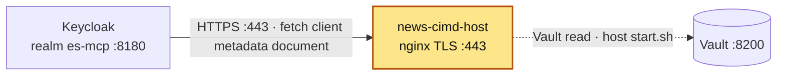

# news-cimd-host

## Purpose

An nginx container that serves news-summary-agent's **OAuth Client ID Metadata Document (CIMD)**
over HTTPS at `https://news-cimd-host/clients/news-summary-app-cimd.json`. That URL *is* the
OAuth `client_id`: when the browser starts a login, Keycloak fetches this document to learn the
client's redirect URIs and grants, instead of the client being pre-registered. Only reachable
from containers on `services_network`.

## How it is set up

| Item | Value |
|---|---|
| Image | `nginx:1.30.6-alpine` |
| Container | `news-cimd-host` |
| TLS | `listen 443 ssl`, `server_name news-cimd-host`, TLSv1.2 + TLSv1.3. Cert `certs/news-cimd-host.crt` (SAN `DNS:news-cimd-host`), signed by `certs/ca.crt` ("docker_services local CA") |
| Secrets | `start.sh` on the **host** reads `NEWS_MCP_CIMD_HOST_TLS_KEY` from Vault (`secret/CREDENTIALS`, override `VAULT_PATH`) and passes it as Compose secret `news_cimd_host_tls_key` → `/run/secrets/news_cimd_host_tls_key` (nginx `ssl_certificate_key`) |
| Content | `/clients/` → `html/clients/*.json`, `application/json`, `Cache-Control: public, max-age=300`; everything else 404 |
| Volumes (ro) | `./nginx.conf` → `/etc/nginx/conf.d/default.conf`; `./certs/news-cimd-host.crt` → `/etc/nginx/tls/`; `./html` → `/usr/share/nginx/html` |
| Healthcheck | `wget http://127.0.0.1:8081/healthz` (second server block bound to container loopback), 15s interval, 5 retries |
| Network | `services_network` (external) |
| Host ports | none |
| Restart | `unless-stopped` |

`make-certs.sh` (run once) creates the CA and server cert in a throwaway `alpine:3.24.2`
container, writes both private keys to Vault with `vault kv patch` (`LOCAL_NEWS_MCP_CIMD_CA_KEY`,
`NEWS_MCP_CIMD_HOST_TLS_KEY`), and deletes them from disk. `certs/` holds only public certs.
It refuses to run if `certs/ca.crt` exists. Server cert expires Dec 2027, CA Feb 2029.

The Keycloak realm backup that used to sit here moved to `../keycloak/backup/realm-export.json`
(see the *Backup* section of the keycloak README).

**Logs:** `news-cimd-host` logs to stdout/stderr. Docker keeps that copy (`docker logs <container>`), rotated at 3 × 10 MB per container with the oldest file deleted automatically (`logging:` in `docker-compose.yml`). [log-collector](../log-collector/README.md) also copies it to `~/github/logs/services/<container>/YYYY-MM-DD.log`, kept 14 days. nginx's `access.log`/`error.log` are symlinks to stdout/stderr, so access and error lines are in both places.

## Where it fits

Slice of the [canonical diagram](../README.md#architecture).



## Depends on / Depended on by

**Depends on**

| Component | What for |
|---|---|
| Vault (host `start.sh`) | `secret/CREDENTIALS` → `NEWS_MCP_CIMD_HOST_TLS_KEY` (TLS private key) |
| `certs/` (from `make-certs.sh`) | public server cert |

**Depended on by**

| Component | What for |
|---|---|
| Keycloak | fetches `https://news-cimd-host/clients/news-summary-app-cimd.json` to resolve the CIMD client; trusts `certs/ca.crt` via the mount `../news-cimd-host/certs/ca.crt` → `/opt/keycloak/conf/truststores/docker-services-local-ca.pem` + `KC_TRUSTSTORE_PATHS` (see keycloak/docker-compose.yml) |
| news-summary-agent (indirect) | uses the document's URL as its `client_id`; its login only works while this host is reachable by Keycloak |

### The metadata document

`html/clients/news-summary-app-cimd.json`:

| Field | Value |
|---|---|
| `client_id` | `https://news-cimd-host/clients/news-summary-app-cimd.json` (must equal the URL) |
| `client_name` | `News Summary App (CIMD)` |
| `redirect_uris` | `http://news-summary-app:8007/auth/callback` |
| `grant_types` | `authorization_code`, `refresh_token` |
| `response_types` | `code` |
| `token_endpoint_auth_method` | `none` (public client, PKCE) |

## Config & secrets

| Kind | Name |
|---|---|
| Vault | `secret/CREDENTIALS` → `NEWS_MCP_CIMD_HOST_TLS_KEY` (read); `LOCAL_NEWS_MCP_CIMD_CA_KEY` + `NEWS_MCP_CIMD_HOST_TLS_KEY` (written by `make-certs.sh`) |
| Host env | `VAULT_ADDR`, `VAULT_TOKEN` (required), `VAULT_PATH` (optional, default `secret/CREDENTIALS`) |
| Compose secret | `news_cimd_host_tls_key` ← env `NEWS_MCP_CIMD_HOST_TLS_KEY` |
| Files | `nginx.conf`, `certs/ca.crt`, `certs/news-cimd-host.crt`, `html/clients/news-summary-app-cimd.json` |

## Run locally

Prerequisites: Vault up and unsealed, `services_network` exists, `certs/` populated.

```bash
export VAULT_ADDR=http://127.0.0.1:8200 VAULT_TOKEN=...
cd ~/github/docker_services/news-cimd-host
./make-certs.sh                 # first time only (needs docker + vault CLI)
./start.sh up -d                # no args = up -d
./start.sh up -d --force-recreate
./start.sh logs -f
```

Start before (or with) Keycloak. After a CA rotation, recreate Keycloak too.

## Test

```bash
docker inspect -f '{{.State.Health.Status}}' news-cimd-host
docker exec news-cimd-host wget -qO- http://127.0.0.1:8081/healthz      # ok
# Fetch the document over TLS from the network, verifying against the local CA:
docker run --rm --network services_network -v "$PWD/certs/ca.crt:/ca.crt:ro" curlimages/curl:8.21.0 \
  -s --cacert /ca.crt https://news-cimd-host/clients/news-summary-app-cimd.json
openssl x509 -in certs/news-cimd-host.crt -noout -subject -enddate -ext subjectAltName
```

## Ports

| Host | Container | Bind | Note |
|---|---|---|---|
| — | 443 | `services_network` only | HTTPS, CIMD documents |
| — | 8081 | container 127.0.0.1 | `/healthz` |

(`docker ps` also lists `80/tcp`: the image's EXPOSE; nothing listens there with this config.)

## Troubleshooting

| Symptom | Cause | Fix |
|---|---|---|
| nginx exits, logs an error loading `/run/secrets/news_cimd_host_tls_key` | started without `start.sh`, or the Vault key is empty | `./start.sh up -d --force-recreate` |
| `start.sh`: `set VAULT_TOKEN` | env not exported | `export VAULT_ADDR=... VAULT_TOKEN=...` |
| Keycloak login error about client metadata / TLS | Keycloak does not trust the CA (CA re-made but Keycloak not recreated) or cert SAN mismatch | recreate keycloak; SAN must be `news-cimd-host` |
| Keycloak still serves old metadata | Keycloak cache + `max-age=300` | wait 5 min or restart keycloak |
| `make-certs.sh`: `certs/ca.crt already exists` | safety check | remove `certs/` only if you mean to rotate the CA (then update Vault, recreate this and keycloak) |
| Cert expired | server cert valid until Dec 2027 | rotate with `make-certs.sh` |
