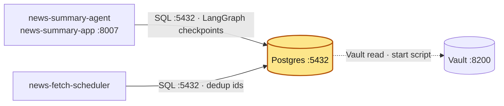

# postgres

## Purpose

PostgreSQL 16, the relational store of the news pipeline. Two applications use it:

- **news-summary-agent**: LangGraph conversation state (checkpoints) via `AsyncPostgresSaver`.
- **news-fetch-scheduler**: the `news_article_ids` table that remembers which articles were
  already published to Kafka (dedup across restarts).

## How it is set up

| Item | Value |
|---|---|
| Image | `local/postgres-vault:16.14`, built from `Dockerfile` (`FROM postgres:16.14` + `curl`, copies `start-postgres.sh`) |
| Container | `postgres` |
| Command | `bash /start-postgres.sh` → `exec docker-entrypoint.sh postgres` |
| Secrets | `start-postgres.sh` **inside the container** reads the token from Compose secret `/run/secrets/vault_token` (from host `VAULT_TOKEN`), waits for Vault, `GET $VAULT_ADDR/v1/secret/data/CREDENTIALS`, parses `POSTGRES_USER`, `POSTGRES_PASSWORD`, `POSTGRES_DB` with perl `JSON` (KV v2 or v1), exports them for the official entrypoint |
| Env | `VAULT_ADDR=http://vault-server:8200`, `VAULT_SECRET_PATH=secret/data/CREDENTIALS`, `PGDATA=/var/lib/postgresql/data/pgdata`, `PGUSER=postgres` |
| Volumes | named volume `postgres-data` → `/var/lib/postgresql/data/pgdata`; `./start-postgres.sh` → `/start-postgres.sh` |
| Healthcheck | `pg_isready -U postgres -d postgres`, 10s, 10 retries, 60s start |
| Networks | `vault-network`, `services_network` |
| Restart | `unless-stopped` |

`POSTGRES_*` from Vault only take effect when the data directory is empty (first init); later
changes in Vault do not change the existing role password.

`diagnose.sh` lists networks and tests which network reaches `vault-server:8200`
(runs a throwaway `alpine:3.24.2` container).

### Schema (checked live, read-only)

The database and the role are both named `postgres` (the only non-template database; the
role both apps connect as). Tables in schema `public`:

| Table | Created by | Used by |
|---|---|---|
| `checkpoints`, `checkpoint_blobs`, `checkpoint_writes`, `checkpoint_migrations` | `AsyncPostgresSaver.setup()` in news-summary-agent (`src/adapters/lifespan.py`) on every start (idempotent) | news-summary-agent |
| `news_article_ids` (`article_id_hash varchar NOT NULL` PK `news_article_ids_pk`, `created_at date NOT NULL`) | `news-fetch-scheduler/db/news_article_ids.sql` (idempotent DDL; run by hand, not by the app) | news-fetch-scheduler |

**Logs:** `postgres` logs to stdout/stderr. Docker keeps that copy (`docker logs <container>`), rotated at 3 × 10 MB per container with the oldest file deleted automatically (`logging:` in `docker-compose.yml`). [log-collector](../log-collector/README.md) also copies it to `~/github/logs/services/<container>/YYYY-MM-DD.log`, kept 14 days.

## Where it fits

Slice of the [canonical diagram](../README.md#architecture).



## Depends on / Depended on by

**Depends on**

| Component | What for |
|---|---|
| Vault | `secret/CREDENTIALS` → `POSTGRES_USER`, `POSTGRES_PASSWORD`, `POSTGRES_DB` (superuser + initial DB) |
| `postgres-data` volume | all data |

**Depended on by**

| Component | What for |
|---|---|
| news-summary-agent | LangGraph checkpoints via `AsyncPostgresSaver` (tables `checkpoints*`, created by `saver.setup()`); connection pool, autocommit; `PG_HOST: postgres`, `PG_PORT: 5432`; DB/user/password from env `POSTGRES_DB`/`POSTGRES_USER`/`POSTGRES_PASSWORD` (Vault `secret/CREDENTIALS`) |
| news-fetch-scheduler | table `news_article_ids(article_id_hash, created_at)`: on start loads hashes from today and the previous `DEDUP_WINDOW_DAYS` (2) full days into memory; `INSERT ... ON CONFLICT DO NOTHING` per new article (MD5 of the article id); psycopg 3, same `POSTGRES_*` env from Vault |

Both apps connect with the same Vault credentials to the same database.

## Config & secrets

| Kind | Name |
|---|---|
| Vault | `secret/CREDENTIALS` (`VAULT_SECRET_PATH=secret/data/CREDENTIALS`) → `POSTGRES_USER`, `POSTGRES_PASSWORD`, `POSTGRES_DB` |
| Compose secret | `vault_token` ← host env `VAULT_TOKEN` |
| Env | `VAULT_ADDR`, `VAULT_SECRET_PATH`, `PGDATA`, `PGUSER` |
| Files | `Dockerfile`, `start-postgres.sh`, `diagnose.sh` |

`start-postgres.sh` logs the user and DB names (not the password); on failure it lists key
names present at the path, never values.

## Run locally

Prerequisites: Vault up and unsealed; `vault-network`, `services_network` exist.

```bash
export VAULT_TOKEN=...
cd ~/github/docker_services/postgres
docker compose up -d --build
docker compose logs -f postgres      # "Secrets loaded successfully"
```

Also included by the root `../docker-compose.yml`. Start before news-summary-agent and
news-fetch-scheduler. On a fresh volume, create `news_article_ids` before starting the
scheduler with `news-fetch-scheduler/db/news_article_ids.sql` (the file has the command).

## Test

```bash
docker inspect -f '{{.State.Health.Status}}' postgres
docker exec postgres pg_isready -U postgres -d postgres
pg_isready -h 127.0.0.1 -p 5432
docker exec postgres psql -c '\dt'
docker exec postgres psql -c '\d news_article_ids'
docker exec postgres psql -Atc 'select count(*) from checkpoints'
./diagnose.sh                         # Vault reachability per network
```

## Ports

| Host | Container | Bind |
|---|---|---|
| 5432 | 5432 | 127.0.0.1 |

## Troubleshooting

| Symptom | Cause | Fix |
|---|---|---|
| `VAULT_TOKEN set = NO` / `❌ VAULT_TOKEN not set` | compose run without `VAULT_TOKEN` exported | `export VAULT_TOKEN=...`; `docker compose up -d --force-recreate` |
| `❌ Vault not reachable after 30 attempts` | Vault sealed/down, or not on `vault-network` | unseal; `./diagnose.sh` |
| `❌ One or more secrets empty` (+ key list) | key missing at `secret/CREDENTIALS` | add `POSTGRES_USER` / `POSTGRES_PASSWORD` / `POSTGRES_DB` |
| App auth fails after changing the Vault password | role password set only at first init | `ALTER ROLE ... PASSWORD` in psql, or reset the volume |
| Scheduler: `relation "news_article_ids" does not exist` | table not created on this volume | run `news-fetch-scheduler/db/news_article_ids.sql` |
| Agent start fails in `saver.setup()` | DB unreachable or user lacks CREATE on `public` | check network `services_network`, credentials |
