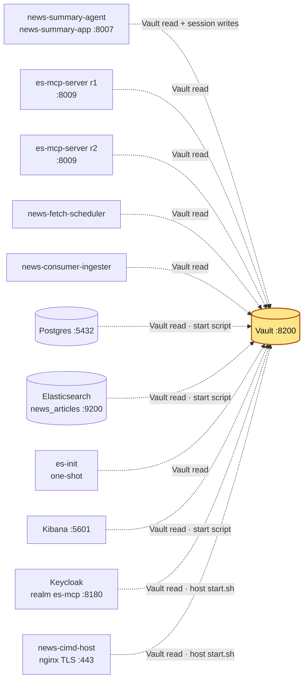

# vault_server

## Purpose

HashiCorp Vault, the single secret store for the news pipeline. Every other service gets its
credentials (DB passwords, API keys, TLS keys, OAuth client secrets) from Vault at start-up;
news-summary-agent also stores its per-login sessions here. If Vault is down or sealed, no other
service can (re)start.

## How it is set up

| Item | Value |
|---|---|
| Image | `hashicorp/vault:1.21.4` |
| Container | `vault-server` |
| Command | `vault server -config=/vault/config/vault.hcl` |
| Storage | `file` backend at `/vault/data` (bind mount `./data`) |
| Seal | Shamir, 5 shares, threshold 3 (checked with `vault status`). Starts **sealed** after every restart/recreate |
| Listener | `0.0.0.0:8200`, `tls_disable = true` (plain HTTP, local dev only) |
| `api_addr` / `cluster_addr` | `http://vault-server:8200` / `http://vault-server:8201` (8201 not published; single node, no HA) |
| UI | enabled (`ui = true`), http://127.0.0.1:8200/ui |
| Secrets engine | KV v2 mounted at `secret/` |
| Volumes | `./config` → `/vault/config` (vault.hcl), `./data` → `/vault/data`, `./logs` → `/vault/logs` |
| Network | `vault-network` (external) only |
| Capabilities | `IPC_LOCK` |
| Healthcheck | `vault status -address=http://localhost:8200` every 10s, 10 retries, 15s start period. `vault status` exits non-zero while sealed, so the container reports unhealthy until unsealed |
| Restart | `unless-stopped` |

Vault does not load secrets itself. It is the source for everyone else.

**Logs:** `vault-server` logs to stdout/stderr. Docker keeps that copy (`docker logs <container>`), rotated at 3 × 10 MB per container with the oldest file deleted automatically (`logging:` in `docker-compose.yml`). [log-collector](../log-collector/README.md) also copies it to `~/github/logs/services/<container>/YYYY-MM-DD.log`, kept 14 days.

## Where it fits

Slice of the [canonical diagram](../README.md#architecture): every dotted arrow ends here.



## Depends on / Depended on by

**Depends on:** nothing but the external `vault-network` Docker network and the host directory
`./data`. Unsealing needs 3 of the 5 unseal keys (kept outside this repo).

**Depended on by** (paths are KV v2 under mount `secret/`; key names only):

| Component | How it reaches Vault | Path → keys used |
|---|---|---|
| postgres | `start-postgres.sh` in container, `vault-server:8200` | `secret/CREDENTIALS` → `POSTGRES_USER`, `POSTGRES_PASSWORD`, `POSTGRES_DB` |
| elasticsearch | `start-elasticsearch.sh` in container | `secret/CREDENTIALS` → `ELASTIC_PASSWORD` |
| es-init | `es-init.sh` in container | `secret/CREDENTIALS` → `ELASTIC_PASSWORD`, `KIBANA_SYSTEM_PASSWORD` |
| kibana | `start-kibana.sh` in container | `secret/CREDENTIALS` → `KIBANA_SYSTEM_PASSWORD`, `KIBANA_ENCRYPTION_KEY` |
| keycloak | `keycloak/start.sh` on the **host** (vault CLI, `127.0.0.1:8200`) | `secret/CREDENTIALS` → `KC_ADMIN_USER`, `KC_ADMIN_PASSWORD` |
| news-cimd-host | `news-cimd-host/start.sh` on the host | `secret/CREDENTIALS` → `NEWS_MCP_CIMD_HOST_TLS_KEY` |
| news-cimd-host/make-certs.sh | host, `vault kv patch` (writes) | `secret/CREDENTIALS` ← `LOCAL_NEWS_MCP_CIMD_CA_KEY`, `NEWS_MCP_CIMD_HOST_TLS_KEY` |
| news-summary-agent | in container (`vault-network`) | `secret/CREDENTIALS` (`POSTGRES_*`, `OPENAI_API_KEY`); `secret/NEWS-SUMMARY-APP/CONFIG` → `SERVICE_CLIENT_SECRET`, `NEWS_APP_SESSION_SECRET`; **writes** `secret/NEWS-SUMMARY-APP/SESSIONS/<sid>` → `refresh_token`, `sub`, and **deletes** expired entries there: a sweep at start-up and then every `SESSION_SWEEP_INTERVAL_SEC` (86400 s, daily) removes sessions not updated for longer than `SESSION_STORE_MAX_AGE_SEC` (39600 s) |
| es-mcp-server r1/r2 | in container | `secret/CREDENTIALS` → `ELASTIC_READ_API_KEY`, `ES_MCP_SERVER_SHARED_SYMMETRIC_KEY` |
| news-fetch-scheduler | in container | `secret/CREDENTIALS` → `POSTGRES_*`, `NEWS_API_KEY` |
| news-consumer-ingester | in container | `secret/CREDENTIALS` → `ELASTIC_API_KEY` |
| mongodb, mongo-express, redis (not news pipeline) | in container, token from Compose secret `vault_token` | `secret/CREDENTIALS` → `MONGO_USER`, `MONGO_PASSWORD` (mongodb, mongo-express), `REDIS_PASSWORD` (redis) |
| cimd-host (legacy) | host start.sh; host make-certs.sh (writes) | `secret/CREDENTIALS` → `MCP_LAB_CIMD_HOST_TLS_KEY`; make-certs.sh writes `LOCAL_CA_KEY`, `MCP_LAB_CIMD_HOST_TLS_KEY` |

Full table: [../README.md#vault-paths](../README.md#vault-paths). Applications load all keys at
their paths into their environment at start-up.

## Config & secrets

- `config/vault.hcl`: storage, listener, `api_addr`, `cluster_addr`, `ui`, `log_level = "info"`.
- Env: `VAULT_ADDR=http://vault-server:8200` (inside the container).
- `data/` holds the encrypted storage. **Never read, copy or commit it** (it is in `../.gitignore`).
- Clients in containers use `http://vault-server:8200` over `vault-network`; host scripts use
  `VAULT_ADDR=http://127.0.0.1:8200` (or `http://vault-server:8200` via `/etc/hosts`).
- The postgres, elasticsearch, mongodb and redis compose projects pass the token to containers
  as the Compose secret `vault_token` (file `/run/secrets/vault_token`) from the host's
  `VAULT_TOKEN`, not as an env var. The four application repos (news-summary-agent,
  es-mcp-server, news-fetch-scheduler, news-consumer-ingester) still pass it as the
  `VAULT_TOKEN` env var. keycloak and news-cimd-host read Vault on the host (vault CLI).

## Run locally

```bash
docker network create vault-network 2>/dev/null || true   # once
cd ~/github/docker_services/vault_server
docker compose up -d
export VAULT_ADDR=http://127.0.0.1:8200
vault operator unseal      # repeat 3 times, one key each
export VAULT_TOKEN=...     # needed by every other service's compose command
```

Start Vault first; see [start order](../README.md#start-order). After any recreate, unseal again
before starting anything else.

## Test

No unit tests. Verify with:

```bash
vault status                                   # Initialized true, Sealed false, Threshold 3
docker inspect -f '{{.State.Health.Status}}' vault-server
curl -s http://127.0.0.1:8200/v1/sys/health | jq '{initialized, sealed, version}'
vault kv metadata get secret/CREDENTIALS        # shows versions only, no values
```

## Ports

| Host | Container | Bind | Note |
|---|---|---|---|
| 8200 | 8200 | 127.0.0.1 | API + UI |
| — | 8201 | not published | cluster port, unused (single node) |

## Troubleshooting

| Symptom | Cause | Fix |
|---|---|---|
| Container `unhealthy`, `vault status` shows `Sealed true` | Vault restarted/recreated; file storage always comes back sealed | `vault operator unseal` with 3 keys |
| Other containers log `Vault not reachable after 30 attempts` | Vault sealed, down, or the client is not on `vault-network` | Unseal; check `docker inspect <c> -f '{{json .NetworkSettings.Networks}}'`; `postgres/diagnose.sh` tests reachability per network |
| Host start.sh fails `set VAULT_TOKEN` / `permission denied` | `VAULT_TOKEN` not exported or lacks policy for the path | `export VAULT_ADDR=http://127.0.0.1:8200 VAULT_TOKEN=...` |
| `vault kv get` returns 404 on `secret/data/...` | KV v2 CLI paths omit `data/`; HTTP API paths need it | CLI: `secret/CREDENTIALS`; HTTP: `/v1/secret/data/CREDENTIALS` |
| `network vault-network not found` | external network missing | `docker network create vault-network` |
